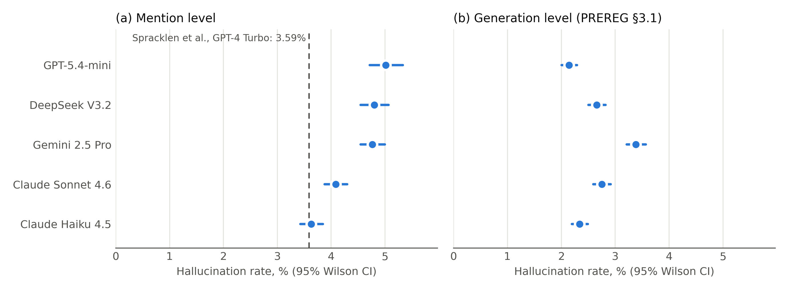
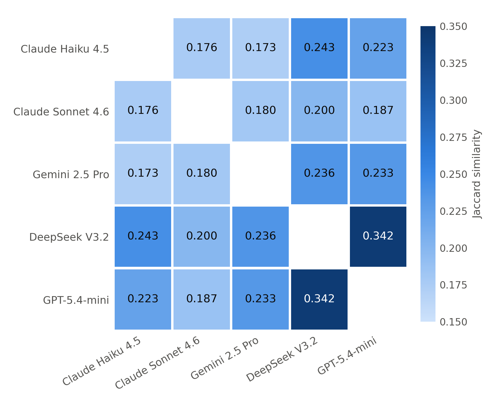

# Tables and figures for v4

Generated by `scripts/v4_tables.py` from `reports/numbers.json` and the private classification (offline). Aggregates and model names only. v4 = live revalidation (stage A, variant c).

## 1. Models: generations, refusals, repeats

Refusal = `generated_code` NULL, 'none' or empty (the stage A rule). Repeats: rows with the same (prompt, model, sample) in `generations`; API calls whose generation row is no longer in the table.

| Model | Generations | Refusals | Refusal % [95% CI] | API calls | Calls without a generation row | Duplicate rows |
| --- | ---: | ---: | ---: | ---: | ---: | ---: |
| Claude Haiku 4.5 | 39,969 | 508 | 1.27 [1.17–1.39] | 39,969 | 0 | 0 |
| Claude Sonnet 4.6 | 39,964 | 7,501 | 18.77 [18.39–19.16] | 39,964 | 0 | 0 |
| Gemini 2.5 Pro | 39,969 | 3,242 | 8.11 [7.85–8.38] | 39,969 | 0 | 0 |
| DeepSeek V3.2 | 39,969 | 789 | 1.97 [1.84–2.12] | 39,969 | 0 | 0 |
| GPT-5.4-mini | 39,969 | 12,593 | 31.51 [31.05–31.96] | 55,486 | 15,517 (2026-04-22 – 2026-04-24) | 0 |

Distinct prompts: 39,969; × 5 = 199,845; rows: 199,840. `sqlite_sequence` for generations: 215,357 (= rows + 15,517 deleted).

Appendix B (v3, per provider) vs the database:

| Provider | v3 Appendix B | Database | Difference |
| --- | ---: | ---: | ---: |
| Anthropic | 79,933 | 79,933 | +0 |
| OpenAI | 39,969 | 39,969 | +0 |
| Google | 39,968 | 39,969 | -1 |
| DeepSeek | 39,975 | 39,969 | +6 |

The database shows repeats only for GPT-5.4-mini: 15,517 API calls of an earlier partial run (2026-04-22 – 2026-04-24) whose generation rows were deleted before the full run. For DeepSeek the database has exactly 39,969 API calls and 39,969 generations, no duplicates; the v3 figure (39,975, +6) is not explained by the database. The same holds for Google (-1).

## 2. Rates by language (v4 = live revalidation), % with 95% Wilson CI; Δ with 95% Newcombe CI

**Mention level**

| Model | Python | JavaScript | Δ Py − JS (pp) | Overall |
| --- | ---: | ---: | ---: | ---: |
| Claude Haiku 4.5 | 4.38 [4.11–4.67] | 2.04 [1.77–2.34] | +2.34 [+1.93, +2.73] | 3.63 [3.43–3.85] |
| Claude Sonnet 4.6 | 5.13 [4.86–5.42] | 1.67 [1.44–1.93] | +3.47 [+3.09, +3.84] | 4.09 [3.88–4.30] |
| Gemini 2.5 Pro | 5.64 [5.35–5.94] | 2.74 [2.44–3.08] | +2.89 [+2.45, +3.32] | 4.77 [4.55–5.00] |
| DeepSeek V3.2 | 5.51 [5.20–5.85] | 2.93 [2.56–3.34] | +2.59 [+2.06, +3.08] | 4.80 [4.55–5.07] |
| GPT-5.4-mini | 5.95 [5.57–6.36] | 2.67 [2.28–3.13] | +3.28 [+2.68, +3.84] | 5.02 [4.72–5.33] |

**Generation level**

| Model | Python | JavaScript | Δ Py − JS (pp) | Overall |
| --- | ---: | ---: | ---: | ---: |
| Claude Haiku 4.5 | 4.15 [3.88–4.44] | 0.69 [0.59–0.81] | +3.46 [+3.16, +3.77] | 2.34 [2.20–2.49] |
| Claude Sonnet 4.6 | 5.11 [4.81–5.43] | 0.60 [0.50–0.71] | +4.51 [+4.19, +4.85] | 2.75 [2.60–2.92] |
| Gemini 2.5 Pro | 5.88 [5.56–6.23] | 1.11 [0.97–1.26] | +4.78 [+4.42, +5.15] | 3.39 [3.21–3.57] |
| DeepSeek V3.2 | 4.68 [4.39–4.99] | 0.81 [0.70–0.94] | +3.88 [+3.56, +4.20] | 2.66 [2.51–2.82] |
| GPT-5.4-mini | 3.85 [3.58–4.13] | 0.59 [0.50–0.71] | +3.25 [+2.97, +3.55] | 2.15 [2.01–2.29] |

## 3. Pairwise differences (mention level, v4)

χ² on 2×2 tables, Holm correction over 10 pairs; permutation test 10 000 resamples, seed 42. Significant pairs: mention level 7/10, generation level 8/10.

| Pair | Δ (pp) | χ² | p_Holm | p_perm | Sig. | Generation level |
| --- | ---: | ---: | ---: | ---: | --- | --- |
| Claude Haiku 4.5 vs GPT-5.4-mini | 1.38 | 56.46 | <0.0001 | <0.0001 | *** | ns (Δ 0.20, p_Holm 0.132) |
| Claude Haiku 4.5 vs DeepSeek V3.2 | 1.17 | 47.47 | <0.0001 | <0.0001 | *** | *** (Δ 0.32, p_Holm 0.013) |
| Claude Haiku 4.5 vs Gemini 2.5 Pro | 1.13 | 50.58 | <0.0001 | <0.0001 | *** | *** (Δ 1.05, p_Holm <0.0001) |
| Claude Sonnet 4.6 vs GPT-5.4-mini | 0.93 | 25.31 | <0.0001 | <0.0001 | *** | *** (Δ 0.61, p_Holm <0.0001) |
| Claude Sonnet 4.6 vs DeepSeek V3.2 | 0.72 | 17.88 | 0.0001 | <0.0001 | *** | ns (Δ 0.09, p_Holm 0.431) |
| Claude Sonnet 4.6 vs Gemini 2.5 Pro | 0.68 | 18.63 | <0.0001 | <0.0001 | *** | *** (Δ 0.64, p_Holm <0.0001) |
| Claude Haiku 4.5 vs Claude Sonnet 4.6 | 0.45 | 8.76 | 0.012 | 0.0030 | *** | *** (Δ 0.41, p_Holm 0.0010) |
| Gemini 2.5 Pro vs GPT-5.4-mini | 0.25 | 1.61 | 0.613 | 0.205 | ns | *** (Δ 1.24, p_Holm <0.0001) |
| DeepSeek V3.2 vs GPT-5.4-mini | 0.22 | 1.06 | 0.613 | 0.294 | ns | *** (Δ 0.51, p_Holm <0.0001) |
| Gemini 2.5 Pro vs DeepSeek V3.2 | 0.03 | 0.03 | 0.862 | 0.864 | ns | *** (Δ 0.73, p_Holm <0.0001) |

## 4. Figure 2

Per-model hallucination rate after live revalidation with 95% Wilson CI: (a) mention level (the unit of the v3 figure), (b) generation level (≥ 1 hallucinated name; denominator = all generations). Dashed line: 3.59% (Spracklen et al., GPT-4 Turbo, `ext/spracklen/Plots/Data/figure_14.csv`), shown on panel (a) only, because Spracklen's unit is the package mention, not the generation. Models are ordered by the mention-level rate in both panels; the x-axis is shared.

## 5. Figure 3: Jaccard similarity of unique hallucinated names (v4)

Mean 0.219, range 0.173–0.342. Maximum: DeepSeek V3.2 – GPT-5.4-mini (0.342; 344 shared of 1005). Minimum: Claude Haiku 4.5 – Gemini 2.5 Pro (0.173; 233 shared of 1344). Sets = names hallucinated as of generation after live revalidation (normalized names). Colour scale spans the data range (not from 0).

| Model | Claude Haiku 4.5 | Claude Sonnet 4.6 | Gemini 2.5 Pro | DeepSeek V3.2 | GPT-5.4-mini |
| --- | ---: | ---: | ---: | ---: | ---: |
| Claude Haiku 4.5 | — | 0.176 | 0.173 | 0.243 | 0.223 |
| Claude Sonnet 4.6 | 0.176 | — | 0.180 | 0.200 | 0.187 |
| Gemini 2.5 Pro | 0.173 | 0.180 | — | 0.236 | 0.233 |
| DeepSeek V3.2 | 0.243 | 0.200 | 0.236 | — | 0.342 |
| GPT-5.4-mini | 0.223 | 0.187 | 0.233 | 0.342 | — |

## 6. Rates by dataset (v4), % with 95% Wilson CI

**Mention level**

| Model | SO_AT | SO_LY | LLM_AT | LLM_LY |
| --- | ---: | ---: | ---: | ---: |
| Claude Haiku 4.5 | 2.03 [1.63–2.51] | 3.46 [3.02–3.95] | 3.79 [3.43–4.19] | 4.19 [3.83–4.59] |
| Claude Sonnet 4.6 | 2.00 [1.60–2.48] | 2.56 [2.21–2.97] | 4.56 [4.19–4.96] | 5.13 [4.76–5.53] |
| Gemini 2.5 Pro | 2.67 [2.25–3.16] | 3.04 [2.66–3.46] | 5.37 [4.96–5.82] | 6.15 [5.72–6.60] |
| DeepSeek V3.2 | 2.68 [2.17–3.31] | 4.15 [3.64–4.74] | 4.97 [4.53–5.45] | 5.70 [5.25–6.19] |
| GPT-5.4-mini | 1.52 [0.97–2.36] | 1.82 [1.38–2.40] | 5.37 [4.88–5.91] | 6.28 [5.77–6.82] |
| All models | 2.28 [2.07–2.52] | 3.10 [2.90–3.31] | 4.79 [4.60–4.98] | 5.44 [5.25–5.64] |

**Generation level**

| Model | SO_AT | SO_LY | LLM_AT | LLM_LY |
| --- | ---: | ---: | ---: | ---: |
| Claude Haiku 4.5 | 0.68 [0.54–0.86] | 1.60 [1.37–1.87] | 3.09 [2.77–3.45] | 4.04 [3.67–4.44] |
| Claude Sonnet 4.6 | 0.67 [0.53–0.85] | 1.24 [1.04–1.48] | 3.99 [3.62–4.40] | 5.17 [4.75–5.62] |
| Gemini 2.5 Pro | 1.01 [0.83–1.22] | 1.73 [1.49–2.01] | 4.80 [4.40–5.24] | 6.09 [5.63–6.58] |
| DeepSeek V3.2 | 0.71 [0.57–0.90] | 1.61 [1.38–1.88] | 3.66 [3.31–4.05] | 4.71 [4.31–5.15] |
| GPT-5.4-mini | 0.18 [0.11–0.28] | 0.36 [0.26–0.50] | 3.49 [3.14–3.87] | 4.63 [4.24–5.07] |
| All models | 0.65 [0.58–0.72] | 1.31 [1.21–1.41] | 3.81 [3.64–3.98] | 4.93 [4.74–5.12] |

## 7. Table 4 (new, without names): the universal set after revalidation

Categories are exclusive, assigned in the order shown. Mentions = hallucinated mentions (v4) summed over the names of the category. Scope ownership and near matches use the master lists of 2026-07-23 (`data/master_lists/2026-07-23/`, PyPI normalized per PEP 503, npm lowercased). A scope counts as owned if at least one package is published under it (owner may be an organisation or a user; outsiders cannot publish there). Near match: Levenshtein distance 1–2 to a listed package; the Python stdlib module names added to the PyPI list are not counted as packages (counting them would move 0 more name(s) into this category). Universal names present verbatim in the 2026-07-23 lists: 0.

| Category | PyPI names | PyPI mentions | npm names | npm mentions | Names | Mentions |
| --- | ---: | ---: | ---: | ---: | ---: | ---: |
| npm scope already owned (packages published under it, e.g. @ember/*) | 0 | 0 | 4 | 148 | 4 | 148 |
| Near match: an existing package within Levenshtein distance ≤ 2 | 74 | 2,183 | 7 | 36 | 81 | 2,219 |
| Plausible invention (neither of the above) | 14 | 307 | 5 | 25 | 19 | 332 |
| **Total (universal set)** | 88 | 2,490 | 16 | 209 | 104 | 2,699 |

**Fate of the April lists (v3 universal set in the database), as in stage A**

| Outcome | PyPI | npm |
| --- | ---: | ---: |
| excluded D1 D11 pipreqs import only | 26 | 0 |
| excluded noise filter | 1 | 0 |
| not universal FALSE POSITIVE | 3 | 2 |
| not universal UNKNOWN as of generation | 3 | 0 |
| still universal | 88 | 16 |
| **Total** | 121 | 18 |

## 8. v3 → v4 (paper format)

v3 = published value (every value checked against the text of v3.pdf); v4 = live revalidation. Full reasons: `reports/diff_v3_vs_new.md`.

| Quantity | v3 | v4 | Main reason |
| --- | --- | --- | --- |
| Generations | 199,845 | 199,840 (stored rows, D6) | generations missing in the database: Claude Sonnet 4.6 5; the v3 total = prompts × 5 |
| Rate Claude Haiku 4.5 | 4.62% | mention 3.63% [3.43–3.85]; generation 2.34% [2.20–2.49] | hallucinated mentions 1394 → 1098: −44 D15, −189 D1/D11, −51 existed before generation, −11 UNKNOWN, −1 spelling variant of an existing name (PEP 503) |
| Rate Claude Sonnet 4.6 | 5.41% | mention 4.09% [3.88–4.30]; generation 2.75% [2.60–2.92] | hallucinated mentions 1866 → 1407: −169 D15, −202 D1/D11, −63 existed before generation, −23 UNKNOWN, −1 spelling variant of an existing name (PEP 503), −1 noise filter on the normalized name |
| Rate Gemini 2.5 Pro | 5.80% | mention 4.77% [4.55–5.00]; generation 3.39% [3.21–3.57] | hallucinated mentions 1974 → 1625: −49 D15, −207 D1/D11, −77 existed before generation, −14 UNKNOWN, −1 spelling variant of an existing name (PEP 503), −1 noise filter on the normalized name |
| Rate DeepSeek V3.2 | 5.89% | mention 4.80% [4.55–5.07]; generation 2.66% [2.51–2.82] | hallucinated mentions 1531 → 1251: −36 D15, −164 D1/D11, −63 existed before generation, −15 UNKNOWN, −2 spelling variant of an existing name (PEP 503) |
| Rate GPT-5.4-mini | 6.10% | mention 5.02% [4.72–5.33]; generation 2.15% [2.01–2.29] | hallucinated mentions 1190 → 982: −7 D15, −144 D1/D11, −45 existed before generation, −12 UNKNOWN |
| Range (mention) | 4.62–6.10% | 3.63% (Claude Haiku 4.5) – 5.02% (GPT-5.4-mini); spread 1.38 pp | published values not reproduced exactly (v3 method on the database: 4.61–6.08%); per-model changes above |
| Range (generation) | — (mention level only) | 2.15% (GPT-5.4-mini) – 3.39% (Gemini 2.5 Pro); spread 1.24 pp | PREREG §3.1 unit; not reported in v3 |
| χ² + Holm (mention) | 5/10 significant; Haiku vs GPT χ² 52.49 | 7/10 significant; Haiku vs GPT χ² 56.46, Δ 1.38 pp | recomputed from the new per-model counts |
| Permutation test (mention) | agrees with χ² on all significant pairs | 7/10 with p<0.05; agrees with χ²+Holm on 10/10 pairs | 10 000 resamples, seed 42 |
| DeepSeek vs Gemini Δ (mention) | 0.08 pp (ns) | 0.03 pp (ns) | recomputed |
| χ² + Holm (generation) | — (mention level only) | 8/10 significant; Haiku vs GPT χ² 3.38, Δ 0.20 pp | PREREG §3.1 unit; not reported in v3 |
| Permutation test (generation) | — (mention level only) | 8/10 with p<0.05; agrees with χ²+Holm on 10/10 pairs | PREREG §3.1 unit; not reported in v3 |
| DeepSeek vs Gemini Δ (generation) | — (mention level only) | 0.73 pp (significant) | PREREG §3.1 unit; not reported in v3 |
| Jaccard mean (range) | 0.222 (0.179–0.343) | 0.219 (0.173–0.342); DeepSeek–GPT 0.342; Haiku–Sonnet 0.176 | sets of names hallucinated as of generation (normalized names) instead of v3 raw keys |
| Python / JS Claude Haiku 4.5 | 5.49 / 2.76 | mention 4.38 / 2.04; generation 4.15 / 0.69 | language split of the per-model changes |
| Python / JS Claude Sonnet 4.6 | 6.63 / 2.62 | mention 5.13 / 1.67; generation 5.11 / 0.60 | language split of the per-model changes |
| Python / JS Gemini 2.5 Pro | 6.75 / 3.61 | mention 5.64 / 2.74; generation 5.88 / 1.11 | language split of the per-model changes |
| Python / JS DeepSeek V3.2 | 6.69 / 3.78 | mention 5.51 / 2.93; generation 4.68 / 0.81 | language split of the per-model changes |
| Python / JS GPT-5.4-mini | 7.27 / 3.14 | mention 5.95 / 2.67; generation 3.85 / 0.59 | language split of the per-model changes |
| LLM vs SO prompts | LLM-synthesized > Stack Overflow | SO_AT 2.28%; SO_LY 3.10%; LLM_AT 4.79%; LLM_LY 5.44% (holds) | recomputed (mention level) |
| Universal set, PyPI (109/121) | 109 | 88 | D1/D11 import-only, pre-existing packages, UNKNOWN; 109 not reproducible (DB: 121) |
| Universal set, npm | 18 | 16 | 2 pre-existing packages |
| Universal set, total (127/139) | 127 | 104 | 109 is not reproducible (the DB and the April list give 121) |
| Registrable (53 = 41 + 12) | 53 (41 PyPI, 12 npm) | not recomputed | registrability is a registry decision (PREREG §2: BLOCKED_BY_REGISTRY only when the registry says so) |
| Refusals Claude Haiku 4.5 | 1.27% | 1.27% | refusal definition (generated_code NULL / 'none' / empty) |
| Refusals Claude Sonnet 4.6 | 18.79% | 18.77% | refusal definition (generated_code NULL / 'none' / empty) |
| Refusals Gemini 2.5 Pro | 8.14% | 8.11% | refusal definition (generated_code NULL / 'none' / empty) |
| Refusals DeepSeek V3.2 | 2.08% | 1.97% | refusal definition (generated_code NULL / 'none' / empty) |
| Refusals GPT-5.4-mini | 32.14% | 31.51% | refusal definition (generated_code NULL / 'none' / empty) |
| Hallucinated mentions per model | more than 1,300 | min 982 | per-model changes above |

## 9. Task 2: registration after exposure

Window: exposure start → T0 (2026-11-07). Exposure start: A1 = arXiv submission of the first version printing the name (v1 2026-05-16, v2 2026-06-11); A2 and B = 2026-04-30.

| Group | PyPI | npm | Total |
| --- | ---: | ---: | ---: |
| A | 88 | 16 | 104 |
| A1 | 6 | 7 | 13 |
| A2 | 82 | 9 | 91 |
| B | 1658 | 520 | 2178 |
| B4 | 97 | 31 | 128 |

Registered share, 95% Wilson CI; difference in pp, 95% Newcombe CI; two-sided Fisher exact test. Common strata: 11.

| Comparison | First group | Second group | Difference (pp) | Fisher p |
| --- | --- | --- | ---: | ---: |
| **Primary: A vs B4, common strata** | 0/87 = 0.0% [0.0–4.2] | 2/101 = 2.0% [0.5–6.9] | -2.0 [-6.9, +2.5] | 0.500 |
| pypi (sensitivity) | 0/76 = 0.0% [0.0–4.8] | 2/97 = 2.1% [0.6–7.2] | -2.1 [-7.2, +3.0] | 0.505 |
| npm (sensitivity) | 0/11 = 0.0% [0.0–25.9] | 0/4 = 0.0% [0.0–49.0] | +0.0 [-49.0, +25.9] | 1.000 |
| A vs all B (descriptive) | 1/104 = 1.0% [0.2–5.2] | 24/2178 = 1.1% [0.7–1.6] | -0.1 [-1.1, +4.2] | 1.000 |
| A1 vs A2 (descriptive) | 1/13 = 7.7% [1.4–33.3] | 0/91 = 0.0% [0.0–4.1] | +7.7 [+0.2, +33.3] | 0.125 |

Minimum detectable effect (pooled, n A = 87, n B4 = 101; power 0.8, α 0.05): baseline 1% → 10.5% in A (+9.5 pp); baseline 2% → 12.5% in A (+10.5 pp); baseline 5% → 18.5% in A (+13.5 pp).
Time from exposure start to creation (registered in the window): A: n = 1, median 47 days (range 47–47); B: n = 24, median 89 days (range 13–153).
Result: no effect detected at this precision.

## 10. Numbers for the text (v4)

| Model | Hallucinated mentions | All mentions | Unique hallucinated names | …PyPI | …npm |
| --- | ---: | ---: | ---: | ---: | ---: |
| Claude Haiku 4.5 | 1,098 | 30,214 | 605 | 462 | 143 |
| Claude Sonnet 4.6 | 1,407 | 34,421 | 798 | 674 | 124 |
| Gemini 2.5 Pro | 1,625 | 34,074 | 975 | 755 | 220 |
| DeepSeek V3.2 | 1,251 | 26,047 | 751 | 576 | 175 |
| GPT-5.4-mini | 982 | 19,570 | 598 | 469 | 129 |
| All models | 6,363 | 144,326 | 2,282 | 1,746 | 536 |

## 11. Extended thinking for Haiku 4.5 and Sonnet 4.6 (code check)

- Sonnet 4.6: `src/slop_bench/config.py:160` `extra_kwargs={}`; comment at `src/slop_bench/config.py:157`: extended thinking is off unless `thinking=...` is passed, and it is never passed.
- Haiku 4.5: `src/slop_bench/config.py:175` `extra_kwargs={}`.
- Synchronous calls: request kwargs are built at `src/slop_bench/orchestrator.py:111` from CODE_GEN_KWARGS and `spec.extra_kwargs` only.
- Batch API (Anthropic): request params at `src/slop_bench/batch.py:140` contain model, max_tokens, temperature, messages; no `thinking`.
- A `thinking` / `budget_tokens` / `thinking_budget` parameter in code (outside comments) under `src/slop_bench/`: 0.
- Fact: the run code passes no extended-thinking parameter for either model. These files are unchanged since commit b142b05 2026-04-28; whether that commit is byte-identical to the code that ran in April cannot be proven from the repository.
